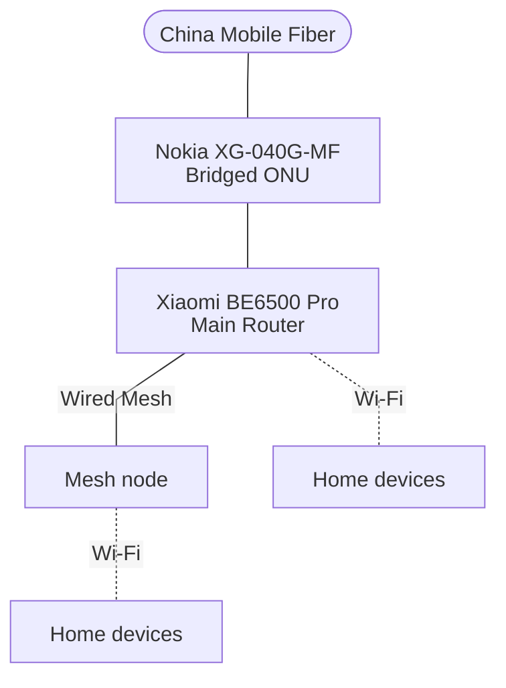

首先介绍一下我家网络的基本情况，湖北移动千兆宽带[^pon][^fttr]，诺基亚贝尔 XG-040G-MF 光猫[^onu]，Xiaomi 路由器 BE6500 Pro。整体思路是将光猫修改为桥接模式，光猫 2.5G 网口连主路由器，主路由器作为中枢网关负责拨号上网，并和 1 个子路由有线 Mesh 组网实现信号全屋覆盖。



## 为什么要改桥接

1. 减轻光猫负荷

   运营商自带的光猫通常配置都较差，改成桥接模式后光猫负责光电信号转换，PPPoE 拨号、NAT、DHCP 和路由等工作交给性能更强的路由器来完成，可以减少光猫负担，充分发挥路由器的性能。

2. 避免双重 NAT

   如果光猫和路由器都使用路由模式工作，都对上网流量做 NAT，就会形成双重 NAT，多一层 NAT 会让家里的网络结构更加复杂，端口映射、远程访问等配置也会更加复杂。

当然还有一些其他优势，这里就不赘述了，上面的理由已经足够打动我修改桥接模式。

## 改桥接前准备

:::danger
动手之前要搞清楚自己光猫的 OLT[^olt] 认证方式。湖北移动宽带使用 SN 认证，所以不需要备份光猫数据就可以开始重置。如果是其他地区使用逻辑 ID 或者 Password 认证，需要先登录光猫后台记录对应数据。
:::

### 获取管理权限

光猫改桥接只能在管理员模式下进行，所以要先获取超级管理员密码登录管理后台，可以直接找宽带运维要，也可以通过下面的方式获取管理权限，以下是我用过的两种光猫获取管理权限的方法。

#### 中国移动 HX5-9s

1. 普通用户登录光猫后台，浏览器访问以下链接开启 `telnet`，并设置登录用户和密码

   http://192.168.1.1/usr=CMCCAdmin&psw=aDm8H%25MdA&cmd=1&telnet.gch

2. 通过 `telnet` 连接光猫：用户名 `CMCCAdmin` 密码 `aDm8H%25MdA`

   ```sh
   telnet 192.168.1.1
   ```

3. 查看管理后台账号密码信息

   ```sh
   sidbg 1 DB p DevAuthInfo
   ```

4. 修改 `CMCCAdmin` 的登录密码

   ```sh
   sidbg 1 DB set DevAuthInfo 0 Pass aDm8H%MdA
   ```

5. 保存修改

   ```sh
   sidbg 1 DB save
   ```

`sidbg` 命令参考

:::details

```sh
# 查看帮助
sidbg 1 DB --help

# 解密配置文件
sidbg 1 DB decry /userconfig/cfg/db_user_cfg.xml
```

:::

#### 诺基亚贝尔 XG-040G-MF

1. 拔掉光纤，长按光猫的 reset 键重置光猫

2. 光猫重启后，使用默认超密登录光猫：用户名 `CMCCAdmin` 密码 `aDm8H%MdA`

3. 访问 http://192.168.1.1/system.cgi?telnet 开启 `telnet`

4. 在管理后台 `应用 - 家庭存储 - FTP` 勾选启用 FTP 并保存，`应用 - 家庭存储 - SAMBA 共享` 勾选启用 Samba 并保存

5. 使用 `telnet` 登录光猫，用户名和密码同光猫背后**普通用户**

6. 输入 `su user_ftp` 切换到 `ftp` 用户，密码同**普通用户**，切换后获得 `root` 权限

7. 输入 `su` 切换到 `root` 用户，输入 `passwd` 可重置 `root` 用户密码

8. 获取 `root` 权限就可以插上光纤正常使用光猫了，如果超密还没有下发，可以使用默认超密登录管理后台

9. 如果超密被动态下发修改，可以再次使用 `telnet` 登录 `root` 或 `user_ftp` 用户，输入以下命令修改超密

   ```sh
   cfgcli -s InternetGatewayDevice.DeviceInfo.X_CT-COM_TeleComAccount.Password aDm8H%MdA
   ```

`cfgcli` 命令参考
:::details

```sh
# 查看帮助
cfgcli --help

# 导出配置文件
cfgcli -a > /tmp/config.xml
```

:::

## 光猫改桥接

通过上面的步骤，我们不仅获得了光猫管理后台超级管理员 `CMCCAdmin` 用户的权限，也获得了光猫操作系统管理员 `root` 的权限，如果超密被远程下发修改了，随时可以使用 `root` 权限修改回来。

使用用户名 `CMCCAdmin` 密码 `aDm8H%MdA` 登录光猫管理后台，在 `网络 - 宽带设置 - Internet 连接` 中将 Internet 的连接方式从**路由**修改为**桥接**，光猫就配置好了，这里需要记一下 Internet 连接绑定了哪几个 LAN 口。

接下来将光猫上绑定到这条 Internet 连接的 LAN 口和路由器 WAN 口连接，进入路由器管理后台，选择路由模式配置 PPPoE 拨号上网，网络就配置好了。

## 桥接后怎么访问光猫

光猫修改为桥接模式后，连接路由器的设备无法直接访问光猫管理后台，可以用网线直连光猫解决但是电脑会断网，最便捷的方式还是通过路由器网络直接访问光猫，但是在路由器的管理后台无法完成所需配置，需要先开启路由器 SSH，再用 `root` 权限登录路由器进行配置。

### 小米路由器开启 SSH

:::info
可以先尝试使用 [xmir-patcher](https://github.com/openwrt-xiaomi/xmir-patcher) 工具直接开启 `ssh`，比如 AX3000 系列
:::

#### 工具下载

- [Xiaomi 路由器 BE6500 Pro 1.0.46 版本固件](https://cdn.cnbj1.fds.api.mi-img.com/xiaoqiang/rom/rd08/miwifi_rd08_firmware_076b5_1.0.46.bin)

  ```sh
  # SHA256 86589b17152873de440ccc78a40422c0bcec2207bdcd4495a5c5102cac7eb970

  # cmd
  certutil -hashfile miwifi_rd08_firmware_076b5_1.0.46.bin sha256

  # bash
  sha256sum miwifi_rd08_firmware_076b5_1.0.46.bin
  ```

- [小米路由器修复工具](https://www1.miwifi.com/miwifi_download.html)

#### 固件版本

检查路由器的系统版本

1. 若当前路由器版本低于 1.0.46，可以直接在后台手动升级，上传下载的 1.0.46 版本固件

2. 若当前路由器版本高于 1.0.46，需要使用小米路由器修复工具进行降级

#### 开启 SSH

安装 1.0.46 版本后，连接路由器登录后台，从浏览器 url 获取 `STOK`，并记录页面上显示的路由器 SN

将下列代码中的 `<STOK>` 替换成上一步的值，在终端中逐行执行

```sh
# 开启 ssh
curl -X POST http://192.168.31.1/cgi-bin/luci/;stok=<STOK>/api/misystem/arn_switch -d "open=1&model=1&level=%0Anvram%20set%20ssh_en%3D1%0A"

# 写入闪存
curl -X POST http://192.168.31.1/cgi-bin/luci/;stok=<STOK>/api/misystem/arn_switch -d "open=1&model=1&level=%0Anvram%20commit%0A"

# 修改 SSH 服务启动脚本，允许 root 登录
curl -X POST http://192.168.31.1/cgi-bin/luci/;stok=<STOK>/api/misystem/arn_switch -d "open=1&model=1&level=%0Ased%20-i%20's%2Fchannel%3D.*%2Fchannel%3D%22debug%22%2Fg'%20%2Fetc%2Finit.d%2Fdropbear%0A"

# 启动 SSH 服务
curl -X POST http://192.168.31.1/cgi-bin/luci/;stok=<STOK>/api/misystem/arn_switch -d "open=1&model=1&level=%0A%2Fetc%2Finit.d%2Fdropbear%20start%0A"
```

命令执行完后，就可以使用 `root` 进行 `ssh` 登录了，默认密码需要通过 SN 码到[小米 SSH 密码计算器](https://miwifi.dev/ssh)获得

#### 软固化

使用 `ssh` 连接路由器，修改 `root` 密码（可选）

```sh
passwd root
```

因为路由器重启会导致 `/etc/init.d/dropbear` 文件自动恢复，因此需要联网安装一个自启动脚本，每次设备重启后自动修改文件，开启 SSH

```sh
# 创建目录
mkdir /data/auto_ssh && cd /data/auto_ssh

# 下载脚本
curl -O https://cdn.jsdelivr.net/gh/lemoeo/AX6S@main/auto_ssh.sh

# 允许脚本执行
chmod +x auto_ssh.sh

# 解锁 SSH 并添加开机自启动
./auto_ssh.sh install
```

#### 固化 SSH

1. 清空 crash 分区并重启

   ```sh
   zz=$(dd if=/dev/zero bs=1 count=2 2>/dev/null) ; printf '\xA5\x5A%c%c' $zz $zz | mtd write - crash
   reboot
   ```

2. 路由器重启后重新连接 SSH，执行以下命令，固化 SSH

   ```sh
   nvram set ssh_en=1
   nvram set telnet_en=1
   nvram set uart_en=1
   nvram set boot_wait=on
   nvram commit
   bdata set ssh_en=1
   bdata set telnet_en=1
   bdata set uart_en=1
   bdata set boot_wait=on
   bdata commit
   reboot
   ```

3. 擦除 crash 分区并重启

   ```sh
   mtd erase crash
   reboot
   ```

4. 恢复系统版本

   上面的操作做完就可以在管理后台自动升级恢复系统版本。

   升级完成后 `ssh` 会无法访问，这个时候可以使用 `telnet` 进行登录，登录名 `root`，密码是上面设置的密码，如果设备恢复过出厂设置，密码则为通过 SN 计算出的密码。

   通过 `telnet` 连接成功后，可以通过软固化操作重新开启 SSH。

### 配置路由器访问光猫

1. 修改网络配置

   把下面这段加到主路由的 `/etc/config/network` 里，`cat` 是给新接口起的名字，`eth1.4` 是我这台路由器上接光猫的 WAN 口，这个要按光猫实际连接路由器的接口来填。

   ```text
   config interface 'cat'
       option proto 'static'
       option ipaddr '192.168.1.2'
       option netmask '255.255.255.0'
       option ifname 'eth1.4'
   ```

   `192.168.1.2` 是分给主路由的地址，`255.255.255.0` 是子网掩码。这样主路由就知道，去 `192.168.1.1` 的包该从接光猫的网口发出去。

2. 重新加载网络配置

   保存文件后在主路由上执行下面这条命令，让刚加的接口配置生效。

   ```bash
   /etc/init.d/network reload
   ```

3. 修改防火墙运行时规则（重启后需重新应用）

   ```bash
   iptables -I forwarding_rule -d 192.168.1.1 -j ACCEPT

   iptables -t nat -I postrouting_rule -d 192.168.1.1 -j MASQUERADE
   ```

   第一条管去程。`-I` 把规则插在指定链的开头，`-d 192.168.1.1` 限定目的地址，`ACCEPT` 放行匹配的转发流量。

   第二条管回程。包从主路由发给光猫前，`MASQUERADE` 把源地址换成出接口的地址，也就是上面配置的 `192.168.1.2`。这样光猫可以直接回包给主路由，主路由再把回包转给发起访问的电脑。

配好后，让电脑继续连着主路由，在浏览器打开 http://192.168.1.1 能看到光猫登录页，就说明从电脑到光猫的这条路通了。

[^onu]: **ONU（Optical Network Unit，光网络单元）**：家里的光猫就是一种 ONU。它一头接运营商的光纤，另一头通过网口接路由器，在光信号和电信号之间做双向转换。

[^olt]: **OLT（Optical Line Terminal，光线路终端）**：放在运营商机房，是光猫的上级设备。一台 OLT 可以通过分光器连接多台 ONU，负责它们的接入和带宽分配。

[^pon]: **PON（Passive Optical Network，无源光网络）**：连接 OLT 和 ONU 的光纤接入网络。“无源”指中间的分光器等器件不用供电，两端的 OLT 和 ONU 仍然需要供电。

[^fttr]: **FTTR（Fiber to the Room，光纤到房间）**：光纤入户通常叫 FTTH（Fiber to the Home）。FTTR 再往里走一步，把光纤从户内主设备铺到各个房间。
